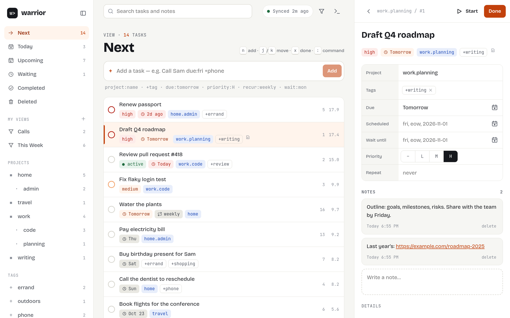
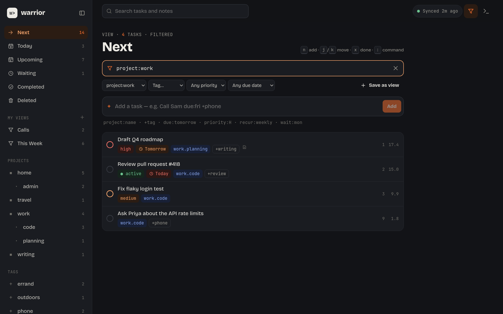
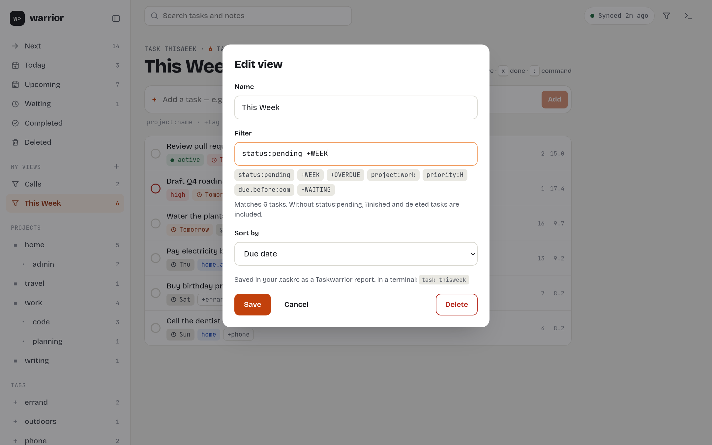
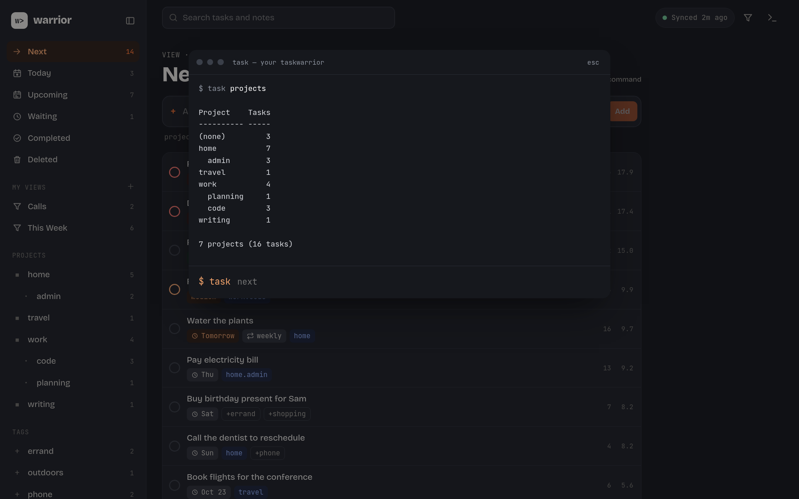

# warrior

A desktop app for [Taskwarrior](https://taskwarrior.org) 3. Every read and every change goes through
the `task` program already on your computer, with your own `.taskrc`, so filters, urgency, dates,
recurrence, contexts, UDAs, reports and hooks behave exactly as they do in your terminal.

Not affiliated with the Taskwarrior project.

Sponsored by:

- **[Margin](https://marginpaper.com)**: hyperlinked PDF planners, journals and templates for
  reMarkable and other e-ink tablets.
- **[taskwarriorsync](https://taskwarriorsync.com)**: hosted sync for Taskwarrior 3, with your tasks
  encrypted on your machine before upload.
- **[Talisim](https://talisim.com)**: travel eSIMs for 202 countries and territories, installed by
  QR code before you fly.



## Features

- **Your own Taskwarrior.** warrior runs `task` with an argument list (never a shell) and reads
  `task export`. It keeps no task database of its own. Change something in a terminal and the app
  picks it up within a second.
- **Views:** Next (by urgency), Today, Upcoming, Waiting, Completed and Deleted, plus one per
  project and tag.
- **Quick add with Taskwarrior's own syntax.** `Call Sam due:fri +phone project:home` goes straight
  to `task add`.
- **Edit in place.** Project, tags, due, scheduled and wait dates, priority, recurrence and notes
  (annotations). Dates such as `eow` or `monday` mean what they mean to `task`.
- **Filter any view** with a Taskwarrior filter (press `f`), using pickers for project, tag,
  priority and due date.
- **Saved views are Taskwarrior reports.** "This Week" is saved in `.taskrc` as
  `report.thisweek.filter=status:pending +WEEK`, so `task thisweek` shows the same list in a
  terminal. Reports you already wrote by hand show up in the sidebar.
- **Command line.** Press `:` to run any `task` command and see its output.
- **Sync** with `task sync`, using the settings already in your `.taskrc`. Settings can set up a
  TaskChampion sync server for you, and can repair the "410 Gone" error you may get the first time
  a machine with existing tasks joins a server.
- **Reminders** as desktop notifications: when tasks come due, a set time before, or a daily
  digest, each limited by a filter if you like. The app can stay in the system tray and start at
  login.
- Light and dark themes, keyboard driven, and still usable in a narrow window.







## Requirements

- **Taskwarrior 3.0 or later.** warrior explains how to install it if it can't find `task`, and
  offers to create an empty `.taskrc` if you don't have one.
- **Linux or macOS.** On Windows, Taskwarrior runs inside WSL, and warrior can run `task` there
  (Settings → Your task setup). This hasn't had much testing yet.

## Building

There are no release builds yet, so build it yourself. You need Rust (1.82 or later), Node 20 or
later, and the [Tauri prerequisites](https://tauri.app/start/prerequisites/) for your platform. On
Linux that's WebKitGTK 4.1, for example:

```sh
sudo apt install libwebkit2gtk-4.1-dev libayatana-appindicator3-dev librsvg2-dev   # Debian, Ubuntu
sudo dnf install webkit2gtk4.1-devel libappindicator-gtk3-devel librsvg2-devel      # Fedora
sudo xbps-install libwebkit2gtk41-devel gtk+3-devel libsoup3-devel librsvg-devel   # Void
```

The tray icon needs libayatana-appindicator (or libappindicator). Without it, warrior runs without
a tray icon.

Then:

```sh
git clone https://github.com/unixmonks/warrior
cd warrior
npm install
npm run dev     # run the app with hot reload
npm run build   # installers in target/release/bundle
```

## Keyboard

| Key | Does |
| --- | --- |
| `n` or `a` | add a task |
| `j` / `k` | move down / up |
| `Enter` | open the task |
| `x` | mark done (or undo) |
| `/` | search |
| `f` | filter with a Taskwarrior filter |
| `:` | command line |
| `Esc` | close the panel |
| `Ctrl+B` | show or hide the sidebar |
| `Ctrl+,` | settings |

## How it works

| Path | What it is |
| --- | --- |
| `core/` | `warrior-core`: finds and runs `task` (argv only, one command at a time, timeouts), the task cache, saved views, sync and reminders. No GUI dependencies. |
| `src-tauri/` | The Tauri 2 app: commands for the window, a watcher on the data directory, background sync and reminders, and the tray icon. |
| `src/` | The React UI. `src/tauri.ts` connects it to the Rust commands. |

[docs/design.md](docs/design.md) covers which `task` commands are run and why.

## Development

```sh
npm test            # core tests, against the real `task` on this machine
npm run typecheck
cargo clippy --all-targets
cargo fmt --check
```

The integration tests in `core/tests/task.rs` need Taskwarrior 3 installed. They use temporary
data and config directories and never touch your tasks.

## License

[MIT](LICENSE)
